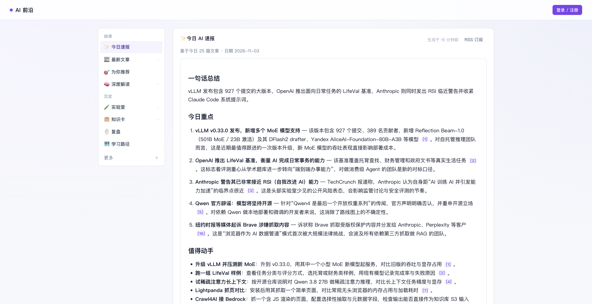
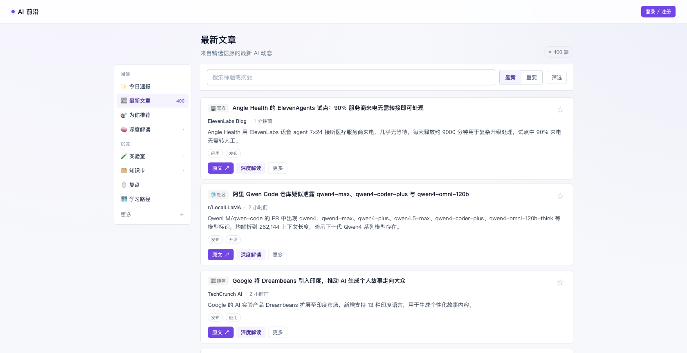
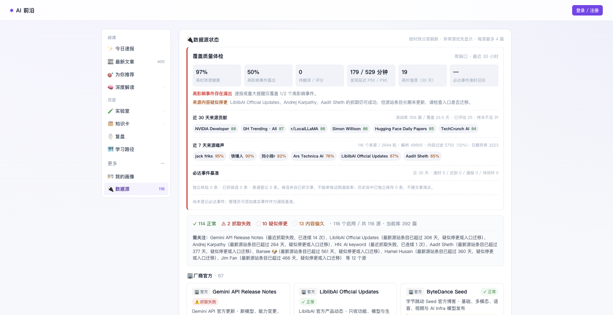

# AI Frontier Agent

[English](README.md) | **简体中文**

[](https://github.com/nikefd/ai-frontier-agent/actions/workflows/ci.yml)
[](LICENSE)

**可自托管的 AI 技术情报站：跟踪官方发布，生成有引用的中文速报，并记录值得尝试的实验。**

适合希望持续跟进模型、API、开源工具和重要研究的开发者。支持自己的 OpenAI-compatible 模型服务；不配置模型也能抓取和浏览资讯。

**[在线体验](https://ai.zhangyangbin.com/?lang=zh) · [今日速报](https://ai.zhangyangbin.com/summary?lang=zh) · [最新文章](https://ai.zhangyangbin.com/feed?lang=zh) · [RSS 订阅](https://ai.zhangyangbin.com/rss/digest.xml)**

[](https://ai.zhangyangbin.com/summary?lang=zh)

右上角可切换中文 / English，选择会保存在当前浏览器。也可通过 `?lang=en` 分享英文页面。英文模式优先展示原文标题和摘要；新生成的速报提供中英两个版本，个人 AI 产物按界面语言生成，已有内容保留原语言。

## 能做什么

- **跟踪一手变化**：116 个内置信源，模型/API 官方源每小时检查，常规内容每 4 小时、论文与发现源每 12 小时检查。
- **减少重复阅读**：相关性过滤、同事件聚合、中文翻译和带原文引用的每日速报；支持 RSS 订阅 `/rss/digest.xml`。
- **保存阅读入口**：搜索、筛选和分页同步到网址，刷新、切换语言或分享链接后保留条件。
- **可视化学习上下文**：`/context` 提供公开离线教学，联动查看上下文占比、工具调用与结果、两轮请求差异和最小 Agent 部件，无需密钥、不调用模型。
- **把阅读变成实践**：按需深度解读、结构化实验卡、进度和结果笔记，可交给对话助手逐步讨论。
- **看清覆盖质量**：来源健康、内容陈旧度、噪声率和发现延迟可查；人工必达基准会保留最早命中证据，文章淘汰后仍可核验。
- **保留自己的资料**：收藏、解读、实验和对话按用户隔离，数据存于自己的文件卷。

## 界面预览

**最新文章**：按时间或重要性浏览中文摘要，搜索感兴趣的话题，直接打开原文或进一步解读。

[](https://ai.zhangyangbin.com/feed?lang=zh)

**数据源与覆盖质量**：查看抓取健康、内容新鲜度及已登记事件的覆盖情况。

[](https://ai.zhangyangbin.com/sources)

截图来自 2026-11-03 的公开页面，内容会随资讯更新。

## 快速开始：Docker Compose

需要 Docker 和 Docker Compose。在交互终端执行：

```bash
git clone https://github.com/nikefd/ai-frontier-agent.git
cd ai-frontier-agent
cp .env.example .env

# 可选：在 .env 填 AIF_LLM_API_KEY；默认使用 DeepSeek。
# 使用其它兼容服务时同时配置 AIF_LLM_BASE_URL 和 AIF_LLM_MODEL。
docker compose build

# 首次部署：在服务器终端创建管理员，密码隐藏输入。
# 先初始化再启动公开服务，避免任何人通过网页抢注管理员。
docker compose run --rm --no-deps ai-frontier \
  python -m app.bootstrap_admin --email you@example.com

docker compose up -d
```

打开 **[http://127.0.0.1:9702/](http://127.0.0.1:9702/)**，使用刚创建的账号登录，点“立即抓取”。初始数据为空，抓取后才会出现资讯。管理员已存在时跳过初始化命令；重复初始化会拒绝，不会覆盖原账号。网页注册只创建普通用户；尚未初始化时返回明确提示。

Compose 启动应用、RSSHub 与 Redis 三个服务。应用数据保存在命名卷 `ai-frontier-data`，升级镜像不会清空该卷。

## 配置与费用

| 配置 | 用途 |
|---|---|
| `AIF_LLM_API_KEY` | 翻译、速报、解读与对话使用的模型密钥；兼容 `DEEPSEEK_API_KEY` 回退 |
| `AIF_LLM_BASE_URL` / `AIF_LLM_MODEL` | 默认 DeepSeek，可换为自己的 OpenAI-compatible 服务 |
| `AIF_SECRET_KEY` | 公网部署建议设置随机会话签名密钥 |
| `AIF_COOKIE_SECURE=1` | HTTPS 公网部署时设置 |
| `AIF_SMTP_*` / `AIF_PUBLIC_BASE_URL` | 普通用户邮箱验证与找回密码；自用管理员无需 SMTP |
| `TWITTER_AUTH_TOKEN` | 可选的 X 来源登录凭证，仅提供给私有 RSSHub |

模型调用费用由部署者承担。双语速报在同一次请求生成两个版本，会比单语使用更多输出 token；切换界面和读取缓存不会发起模型调用。未配置模型时，资讯抓取/浏览可用，LLM 功能不可用。未配置 X 登录态时，部分社交来源不可用；官方 RSS、API 和文档来源独立运行。

完整变量见 [.env.example](.env.example) 和[配置参考](llmdoc/reference/config-reference.md)。生产域名、反向代理和数据持久化见[部署指南](llmdoc/guides/how-to-deploy.md)。

## 备份与恢复

完整数据卷可离线备份，并按 SHA-256、JSON 和 SQLite 完整性检查后恢复到新目录。操作步骤、隔离演练与配置保存见[备份恢复指南](llmdoc/guides/backup-and-restore.md)。

## 本地开发与贡献

```bash
python3 -m venv .venv
source .venv/bin/activate
pip install -e ".[dev]"
cp .env.example .env
# 本地开发把 .env 中 AIF_RSSHUB_BASE 改为 https://rsshub.app。
(cd frontend && npm ci && npm run build)
python -m app.bootstrap_admin --email you@example.com
uvicorn app.main:app --port 9702 --reload
```

运行 `pytest` 验证后端，`cd frontend && npm run build` 验证前端。欢迎贡献稳定的一手信源适配、日期解析回归与部署体验改进。详见[贡献指南](CONTRIBUTING.md)、[文档索引](llmdoc/index.md)和[安全政策](SECURITY.md)。

## 使用边界

来源访问可能受网络、限流、登录态或页面变化影响。质量指标对应已配置来源和已登记事件，不代表全网完整召回。AI 摘要和实践建议需要结合原文核验。公开内容服务需要自行确认来源条款和内容再分发权限。

## 许可证

本项目原创软件与文档采用 [Apache-2.0](LICENSE)。第三方依赖和来源内容保留各自权利，见 [THIRD_PARTY_NOTICES.md](THIRD_PARTY_NOTICES.md)。
