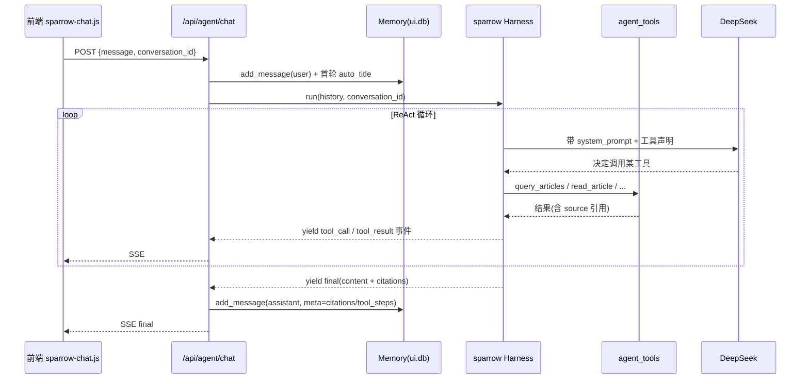

# 对话 Agent 架构

> 讲清楚 `/api/agent/chat` 这个 sparrow 驱动的 ReAct agent 怎么工作：它和旧 `/chat`
> 的区别、工具怎么注入、对话记忆存哪、SSE 事件怎么流。涉及文件：`app/agent_chat.py`、
> `app/agent_tools.py`，以及内联的 agent 运行时 `app/agent_runtime/`（原 `sparrow` 框架，已内联进仓库，见其 README）。

## 1. 从直通 chat 升级到 ReAct agent

项目里有**两个**对话端点（历史演进，见 [backend-architecture](backend-architecture.md) 第 6 节）：

- `POST /api/ai-news/chat`（旧）：无工具，把最近 10 篇文章塞进 system prompt 后直通 LLM。前端已不用。
- `POST /api/agent/chat`（新，前端在用）：sparrow `Harness` 跑的 ReAct agent，能调工具、带引用、有对话记忆。

本文只讲新的那个。

## 2. 运行结构



### 2.1 sparrow 接线（`agent_chat.py`）

```python
from .agent_runtime import AgentConfig, Harness, Memory, configure as llm_configure

llm_configure(base_url=settings.llm_base_url, api_key=settings.llm_api_key, model=settings.llm_model)
_memory = Memory(str(UI_DB))   # <data_dir>/ai-news/ui.db

AgentConfig(
    system_prompt=SYSTEM_PROMPT,
    tools=ALL_TOOLS,                               # 来自 agent_tools.py
    recall_provider=_memory.journal_summary_for_prompt,
)
Harness(config, journal_fn=_memory.journal_append)
```

要点：

- **agent 用 sparrow 自己的 LLM 客户端**（`sparrow.configure` 配的），不经过 `app/llm_client.py`。两条 LLM 链路独立但共用同一个 DeepSeek key / base_url / model。
- `Memory` 是模块级单例，封装对 `ui.db` 的全部读写（对话、消息、journal）。
- `recall_provider` 让 agent 在每轮把历史 journal 摘要带进 prompt（跨轮记忆）。

### 2.2 SYSTEM_PROMPT 的硬规则

system prompt（英文写，见 `agent_chat.py`）给 agent 定了几条铁律：

1. 涉及具体文章/源/track 时**必须先调工具**，不许编造标题/日期/事实。
2. 只用工具结果回答；数据里没有就直说。
3. 用用户的语言回复（中文问中文答），简洁、结论先行、关键词加粗。
4. 想持续追踪某主题时可**建议**建 track，但**用户明确同意后才调** `create_track`。

### 2.3 对话与记忆（`ui.db`）

- 每条用户消息进来先 `add_message(conv_id, "user", ...)`；首轮 `auto_title` 生成会话标题（SSE 推 `title` 事件）。
- `Harness.run` 接收完整历史（从 `Memory.get_messages` 读出），跑完把 assistant 回复连同 `citations` / `tool_steps` 元数据存回。
- 会话管理端点：`GET /conversations`、`GET /conversations/{id}`、`DELETE /conversations/{id}`。
- 前端用 `localStorage` 存 `conversation_id`（`storageKey: 'aif_conv_id'`），刷新后恢复整条线程。

### 2.4 SSE 事件类型

`event_stream()` 把 harness 产出的事件逐个 `data: {json}\n\n` 推给前端：

| 事件 type | 含义 |
|---|---|
| `title` | 首轮自动生成的会话标题 |
| `tool_call` | agent 决定调某工具 |
| `tool_result` | 工具返回（带 `label` / `summary`） |
| `final` | 最终回复（`content` + `citations`） |
| `error` | 出错 |

## 3. 工具集（`agent_tools.py`）

用 sparrow 的 `@tool` 装饰器声明，**每请求按当前用户构造**：`build_tools(uid)` 返回一组绑定了 uid 的工具闭包（多用户隔离，见 [认证架构](auth-architecture.md) 第 4 节）。分读写两组，**写工具只碰该用户自有配置**（其 tracks.json / pins.json），不动全局抓取产物。每个结果都带 `source` 供 agent 引用。

| 工具 | 组 | 作用 | 触碰 |
|---|---|---|---|
| `query_articles` | 读 | 按 keyword/category/track/pinned 搜文章，新→旧 | articles.json |
| `query_tracks` | 读 | 列用户的追踪主题 | tracks.json |
| `read_article` | 读 | 按 id 读单篇详情 + 已生成的深度解读 | articles.json + deep-dives/ |
| `query_guides` | 读 | 列用户保存的指南 | guides.json |
| `query_sources` | 读 | 列 feed 及其分类/健康 | sources.json |
| `create_track` | 写 | 建追踪主题（用户同意后） | tracks.json |
| `pin_article` | 写 | 收藏/取消收藏文章 | pins.json |

实现细节：

- 工具复用 `routers/ai_news.py` 的 `_load_articles` / `_load_tracks(uid)` / `_load_pins(uid)` / `_parse_ts` 等，逻辑单一来源。
- 工具按 `build_tools(uid)` 绑定当前用户：读 tracks/guides/deep-dives、pin 状态都用该 uid；query_articles 读全局文章但按 uid 叠加 pin。`/api/agent/chat` 经 `require_user` 拿 uid。
- 对话记忆 `ui.db` 也按用户隔离（每用户一个 `users/<uid>/ui.db`），见 [认证架构](auth-architecture.md) 第 4 节。
- `_MAX_ARTICLES=15` 限制单次返回条数，控制 context 预算；返回字段裁剪（标题优先中文、摘要截 200 字）。
- `create_track` 对 keywords 参数做了**强健归一化**：有的模型会把 list 序列化成逗号/JSON 字符串，代码兼容 `["a","b"]` JSON、`a,b,c` 逗号（含中文逗号、顿号、分号）等多种形态。
- 写工具签名带 `conversation_id` 参数（sparrow 注入），但当前实现未用它做按会话隔离。

## 4. 前端组件

对话 UI 用仓库内的 `frontend/public/sparrow-chat.js`，Vite 原样输出到 `/sparrow-chat.js`。`main.js` 先注册安全 Markdown renderer，再执行 `SparrowChat.mount({...})`，因此历史消息和 SSE 最终答案统一经 DOMPurify 清洗。可直接修改组件源码，改完需 `npm run build`。详见 [前端架构](frontend-architecture.md)。
