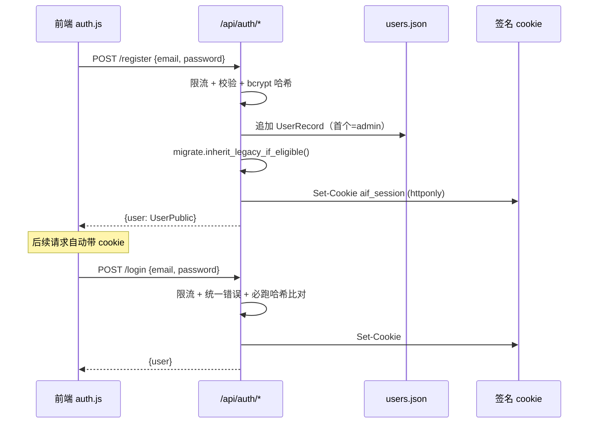

# 认证架构

> 讲清楚多用户鉴权怎么搭起来：用户存储、密码哈希、会话机制、守卫怎么挂、
> 用户产物怎么按用户隔离、老数据怎么迁移。涉及文件：`app/auth.py`、`app/migrate.py`、
> `app/models.py`，以及被守卫的 `app/routers/ai_news.py` / `app/agent_chat.py`。
> 配置项见 [配置参考](../reference/config-reference.md)；安全约束见 [已知问题](../reference/known-issues.md) 第 13/14 条。

## 1. 权限模型

| 身份 | 能做什么 |
|---|---|
| **未登录** | 浏览全局内容：文章流、今日速报、数据源、单篇阅读。用户产物的读（tracks/deep-dives/guides/conversations）返回**空** |
| **未登录禁止** | 任何写（pin/track/guide/删除/fetch/translate）和任何 **LLM 调用**（深度解读/手动新建/速报/指南/对话 agent）→ **401** |
| **登录后** | 可写、可调 LLM，且产物只属于自己 |

实现：写 & LLM 端点挂 `Depends(require_user)`（匿名 401）；用户产物的读挂 `Depends(current_user_optional)`（匿名得空）；全局只读端点不挂。

**admin 角色**：`require_admin`（`auth.py`）在 `require_user` 之上加 `role == "admin"` 校验（非 admin 403）。`/api/admin/*`（用户管理：列表/改角色/删除）全挂它。护栏：admin 不能删/降自己、系统至少留一个 admin。前端用 `body.is-admin` class 控制「用户管理」入口显隐（auth.js 按当前用户 role 切）。端点见 [API 参考](../reference/api-reference.md) 0b 节。

## 2. 数据切分

只有**用户产物**按用户独立，其余全局共享。

| 全局共享（`ai-news/`） | 按用户独立（`users/<uid>/`） |
|---|---|
| `articles.json` 文章主存储 | `tracks.json` 追踪主题 |
| `sources.json` 抓取健康 | `pins.json` 收藏的 article id |
| `summary_today.json` 今日速报 | `guides.json` + `guides/` 指南 |
| `reader-cache/` | `deep-dives/` 深度解读 |
| | `ui.db` 对话记忆 |

认证数据在 `auth/`（`users.json` + `secret.key`），全局。目录细节见 [数据存储参考](../reference/data-storage.md)。

### 2.1 pin 为什么要迁出文章对象

原来 `pinned` 写在全局 `articles.json` 每篇文章上 → 多用户后一个人 pin 了所有人都看到。所以 pin 迁成「用户↔文章」关联：存于 `users/<uid>/pins.json`（article id 列表）。`GET /articles` 读全局文章后**按当前用户叠加** `pinned` / `deep_dive_status`（后者由该用户的 `deep-dives/{aid}.json` 是否存在推导），匿名全为 false/none。文章滚动淘汰（上限 400）的「pinned 不淘汰」保护改为**按所有用户 pins.json 的并集**（`_all_pinned_ids()`）。

## 3. 认证流程

### 3.1 密码哈希

`bcrypt`（自带盐）。`hash_password` / `verify_password` 在 `auth.py`。密码超 72 字节按 bcrypt 规则截断。

### 3.1b 邮箱验证（软提示，不阻断登录）

`UserRecord.email_verified`（默认 False，**首个 admin 自动 True**，免得 SMTP 没配好就把自己锁外面）。流程：

- 注册非 admin 用户 → `_send_verification` 用 `itsdangerous` 签一个独立 salt（`aif-email-verify`，与 session token 隔离）的 token（24h），拼成 `<AIF_PUBLIC_BASE_URL>/api/auth/verify?token=…` 发邮件。
- 用户点链接 → `GET /verify` 校验 token → `mark_email_verified` → 302 跳 `/ui/?verify=ok|invalid`，前端弹 toast。
- 未验证用户**仍可登录使用**，只在顶栏显示「📧 未验证」按钮，点击 `POST /resend-verification` 重发。
- 发信走 `app/email.py`（纯 `smtplib`，零依赖）；SMTP 未配置时**优雅降级**（log warning，注册照常，不发信）。配置见 [config-reference](../reference/config-reference.md) 的 `AIF_SMTP_*` / `AIF_PUBLIC_BASE_URL`。

### 3.1c 修改密码 / 忘记密码找回

复用同一套发信 + 签名 token（三类 token 各用独立 salt：`aif-session` / `aif-email-verify` / `aif-pw-reset`，互不能冒用，有测试 `tests/test_email_verify.py`）。

- **改密码**（已登录）`POST /change-password`：校验旧密码 → 校验新密码 → `set_password` 换哈希 → 重发会话 cookie。
- **忘记密码**（未登录）`POST /forgot-password`：签 reset token（独立 salt，**1h** 过期，比验证的 24h 短）→ 邮件发 `<base>/ui/?reset=<token>`。**防枚举**：邮箱是否存在都返回相同 ok，且限流。
- **重置**（未登录）`POST /reset-password`：校验 token → 换哈希 → 自动登录（下发 cookie）。
- 前端：登录弹窗加「忘记密码？」；顶栏 🔑 改密码；落地 `?reset=<token>` 时弹「设置新密码」表单（`auth.js` 的 `openPwModal`）。
- 已知限制：签名 cookie 无法主动吊销，改密码只重发本会话 cookie，**其他设备的旧 session 仍有效至过期**（同第 13 条取舍）。

### 3.2 会话：无状态签名 cookie

用 `itsdangerous.URLSafeTimedSerializer` 签 `{"uid": uid}` 写入 `aif_session` cookie（**httponly + samesite=lax**，HTTPS 下 + secure）。每请求依赖从 cookie 读 token → 校验签名/过期 → 得 uid → 查 `users.json`。

- 签名密钥 `AIF_SECRET_KEY`：为空时自动生成落 `auth/secret.key`（生产建议显式配，否则连卷重建/多副本会全员登出）。
- **无服务端 session 表** → 登出只清浏览器 cookie，已签发 token 无法主动吊销（只能等过期或换密钥）。取舍见 [已知问题](../reference/known-issues.md) 第 13 条。

### 3.3 防枚举 / 防时序

登录对「邮箱不存在」和「密码错」返回**同一文案**，且邮箱不存在时也跑一次 dummy bcrypt 比对消除时序差。`/login` `/register` 加内存滑窗限流（8 次/60s，按 IP + 邮箱）。

## 4. 对话隔离

sparrow 的 `Memory` 无 user/namespace 维度（`conversations`/`messages`/`journal` 表只认 `conversation_id`，`list_conversations` 不过滤、journal 全局）。所以用**每用户一个 `ui.db`** 做隔离：`agent_chat.py` 的 `_memory_for(uid)` 按 uid 选 `users/<uid>/ui.db` 并缓存 `Memory` 实例。会话列表/读取/删除都基于该用户的 Memory。

agent 工具也按用户绑定：`agent_tools.build_tools(uid)` 每请求构造一组绑定 uid 的工具闭包（读全局 articles 但 pin 状态、tracks/guides/deep-dives 都用该 uid）。

## 5. 数据迁移（老单用户数据归谁）

`app/migrate.py` 两步：

1. **启动时** `migrate_legacy_to_holding()`（幂等，靠 `users/_legacy/` 是否存在判断）：把老的 `ai-news/` 下 `tracks.json` / `guides.json` / `guides/` / `deep-dives/` / `ui.db` 搬到 `users/_legacy/`；从 `articles.json` 抽出 `pinned=True` 的 id 写进 `_legacy/pins.json` 并剥离每篇的 `pinned`；丢弃 `manual` 合成文章（其解读已在 `_legacy/deep-dives/`）。
2. **注册时** `inherit_legacy_if_eligible(user)`：若该用户匹配 `AIF_ADMIN_EMAIL`（未配则首个注册的 admin），把 `_legacy/` 改名成其 uid 目录继承。

约束：没人匹配 `AIF_ADMIN_EMAIL` 时 `_legacy/` 会一直「无主」留存（数据不丢）。不配 `AIF_ADMIN_EMAIL` 由首注册者继承最稳。

## 6. 前端（`static/js/auth.js`）

- 启动 `GET /api/auth/me` 取登录态，渲染顶栏（`#auth-slot`）：未登录显示「登录/注册」，登录显示 email + 登出。
- 登录/注册弹窗（零构建，原生 DOM），不引框架。
- `api.js` 统一拦 401 → 弹登录弹窗（`setUnauthorizedHandler`）。
- 登录/登出后派发 `aif:auth-changed` 事件，`main.js` 据此重载视图；登出清 `localStorage` 的 `aif_conv_id` 避免会话串号。
