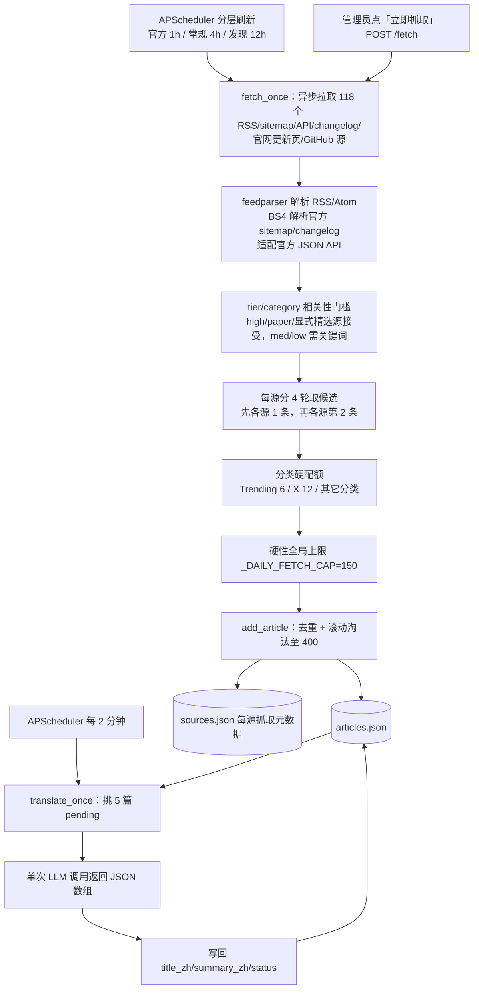

# RSS 抓取管线架构

> 讲清楚「一篇文章从 RSS 源到入库、再被译成中文」端到端怎么发生，以及背后那些
> 配额/打标/容量设计为什么这么定。涉及的文件：`app/workers/ai_news_fetcher.py`、
> `app/workers/ai_news_translator.py`、`app/routers/ai_news.py`（feed 清单 + 关键词表 + 入库）、
> `app/scheduler.py`（定时触发）。

## 1. 总览

## 2. 抓取（`fetch_once`）

### 2.1 触发方式

- **定时**：`scheduler.py` 按 `cadence` 把来源拆成互斥三组，时区 Asia/Shanghai：
  - `fast`：30 个高时效官方源，每小时第 10 分钟检查；覆盖核心实验室新闻、模型/API 更新日志、重要 AI 初创公司和关键开发工具 changelog。
  - `standard`：61 个媒体、博客、社区及普通官方工程源，默认在 01/05/09/13/17/21 点（每 4 小时）检查。
  - `slow`：27 个 paper、X 与 Trending 发现型源，默认在 05:20/17:20（每 12 小时）检查。
- **手动**：admin-only 的 `POST /api/ai-news/fetch` 即时跑一轮（普通用户看不到按钮，直接调用返回 403）。

抓取本身不调用 LLM。三个调度任务只把各自 URL 子集传给同一个 `fetch_once`；它们和管理员手动全量抓取共用进程内锁，文章 URL 去重与 RSSHub 缓存继续避免重叠和重复入库。

### 2.2 feed 清单与分类

118 个内置来源硬编码在 `ai_news.py` 的 `DEFAULT_FEED_SPECS`；管理员确认的自动发现 RSS/Atom、Sitemap 或更新页另存 `custom-sources.json`，启动时合并进同一运行时注册表。普通 RSS/Atom 条目是 `{url, name, tier, category, description}`；内置源根据 `_FAST_SOURCE_NAMES` 与 category 赋 `cadence=fast/standard/slow`，自定义官方源固定为 `vendor/high/fast`。自定义 Sitemap 额外持久化 `format=sitemap + include_paths`，更新页持久化 `format=auto_listing`；`enabled=false` 会同时从默认全量抓取和分层调度中过滤，但仍在数据源页显示供恢复，删除只移除配置与运行时注册，不清理历史文章或 `sources.json` 抓取元数据。无稳定 RSS 的官方站可设置专用 format。当前 Anthropic、ByteDance Seed、Cerebras、DeepSeek、Fireworks AI、LangChain、MiniMax、Modal 与 Mistral 读取官方 sitemap；xAI 官网新闻、Luma 产品/工程页与 Ideogram 博客直接解析服务端 HTML，xAI Python SDK、PyTorch、SGLang、Transformers 与 vLLM 读取所属官方 GitHub Releases API，Z.ai 则读取官方组织的新仓库 API；LiblibAI、OpenRouter、Qwen 与 HF Daily Papers 读取官方 API。OpenAI API 的 Markdown changelog、Gemini API 的 HTML release notes 与 StepFun SPA 内嵌新闻会拆成带真实日期和官方落地链接的独立发布项，Claude Platform、Cursor、ElevenLabs、Lovable、Replit 与 Stability AI 直接读取 RSS。`html_listing` 适配器用每源声明的 CSS selector 解析已知官网；`auto_listing` 则保守提取同站链接、标题与日期明确关联的重复内容卡片。两者都拒绝缺标题或可信日期的条目；Luma 的专用解析器只收 Product/Engineering 卡片，避免大量 SEO 博客与公司合作内容进入文章流。普通 RSS 在截取最新 20 条前统一按发布日期重排，避免 Replit 这类原站混排 feed 漏掉新内容。论文侧使用 Hugging Face Daily Papers 策展接口，结合社区票数、代码可用性和 GitHub stars 排序；四路原始 arXiv 各限最新 2 篇，只承担长尾发现。开放研究和工程侧还覆盖 Ai2、Meta Engineering、Google Cloud AI、Cloudflare AI、Together AI、Ollama 与 MLflow。

`category` 同时驱动前端分组、tier 归一化与抓取配额，共 8 类：

| category | 含义 | 数量 |
|---|---|---|
| `vendor` | 官方实验室 / 厂商第一手发布 | 57 |
| `x-ai` | X(Twitter) 上的 AI 大 V | 21 |
| `community` | 社区 / 周刊（含中文资讯） | 10 |
| `expert` | 专家个人博客 / 独立评测 | 13 |
| `blog` | AI 博客（原始一批） | 6 |
| `media` | 科技媒体 | 5 |
| `trending` | GitHub 热门风向 | 1 |
| `paper` | HF 每日精选 + arXiv 论文类目 | 5 |

启动时 `_DEFAULT_TIER_BY_CATEGORY` 会统一归一化 tier：vendor/blog 为 `high`，media/paper/community/expert 为 `med`，x-ai/trending 为 `low`。这样新增来源即使复制了旧条目的 tier，也不会绕过分类策略。

### 2.3 rsshub.app 主机改写

部分 feed（主要是 Twitter/GitHub）写的是公共 `https://rsshub.app` 主机。模块加载时，若 `AIF_RSSHUB_BASE` 不等于公共实例，就**把所有 `rsshub.app` 前缀 URL 改写到配置的私有实例**（compose 内默认 `http://rsshub:1200`）。

原因：公共 `rsshub.app` 容易对 Twitter 路由限流或返回 403/404；私有实例更可控。Twitter 路由还需在 rsshub 容器配 `TWITTER_AUTH_TOKEN`（x.com 登录态 cookie）。Anthropic/Cohere/Mistral 已改走官方 sitemap，xAI/PyTorch/Transformers/vLLM 走官方 GitHub Releases API，Qwen 走官方文章 API，不受 RSSHub 健康度影响。详见 [部署指南](../guides/how-to-deploy.md)。

### 2.4 相关性门槛

`_decide_relevance()` 在标题+摘要里匹配 `AI_KEYWORDS` 中英关键词表，并结合 tier/category 决定是否进入候选：

- `high`：信任官方/AI 原生编辑源，即使没命中关键词也接受；标记为 `curated`。
- 宽口径 `high`：可配置 `title_keywords` 做来源级标题硬门禁；当前 GitHub Changelog 只收 AI 编程/Agent/MCP/模型更新，NVIDIA 综合博客只收模型、Agent、机器人与 AI 基础设施信号。未命中同样计入 `last_filtered`，不会因官方身份绕过。
- `paper`：arXiv 类目本身已限定 AI/ML，按 curated 接受，避免标题未含通用关键词时漏掉重要论文。
- 显式 `curated=true`：只用于已经确认内容边界就是 AI 的精选刊物、独立评测或结构化模型目录；当前用于 AIGC Weekly、AI资讯日报、Artificial Analysis、METR 与 OpenRouter 模型目录，避免标题没命中通用词时整源被清空。
- `med` / `low`：必须命中关键词才接受；未命中计入该源 `last_filtered`，不会进入文章库或 LLM 富化队列。

这条规则尤其约束 X 与 GitHub Trending：热度只作为发现信号，不能因为“热门”就自动成为 AI 前沿内容。

### 2.5 每源轮次 + 分类硬配额 + 全局上限

`_select_candidates()` 同时解决来源公平、类别失衡和全局容量三个问题：

1. 每个来源内部先按 tier、发布时间排序。
2. 进行 `_PER_FEED_CAP=4` 个分层轮次：先从每个来源取第 1 条，再从每个来源取第 2 条，直到第 4 条；不会让一个高频源先占满 4 个位置后才轮到慢源。
3. 第 4 条之后的候选进入 overflow，等首轮完成后再考虑。
4. 候选按 URL 全局去重：同一文章即使被多个 feed 收录，本轮也只占一个位置。
5. 逐条执行 `_CATEGORY_FETCH_CAPS` 硬上限：vendor 46、media 20、blog 16、paper 14、community 18、expert 18、x-ai 12、trending 6。论文预算从 22 收紧到 14，把 8 个位置让给不断扩充的官方发布；总和仍为 150。
6. 最终无论有多少来源，严格停止在 `_DAILY_FETCH_CAP=150`；分类上限总和也等于 150。

旧实现会先给每个来源直接放入 4 条，79 个来源时 `selected` 本身就可能超过 150，所谓全局上限实际失效；同时 5 路高度重叠 Trending 会重复占位。新实现把 Trending 收敛为 1 路，并在来源轮次之后再执行分类与全局硬限制。

每源抓取结果写入 `sources.json`（按 url 为 key）：`last_fetch` / `last_ok` / `last_error` / `last_error_at` / `last_recovered_at` / `consecutive_failures` / `eligible` / `last_added` / `last_filtered` / `last_invalid_date` / `name` / `tier` / `category`。`last_invalid_date` 是最近一轮因缺失/异常发布时间而拒绝的条目数；成功时连续失败归零，从失败恢复时记录恢复时间。

`GET /sources` 不把“很久没发文章”误判为源故障，而是只判断**抓取运输层**：最近一轮报错为 `error`，从未跑过为 `never`，超过所属 cadence 的 3 个调度间隔（最少 6 小时）没有抓取记录为 `stale`，否则为 `healthy`。响应同时返回 `cadence` 并动态计算当前滚动库内每源最新文章时间；前端显示“每小时 / 每 4 小时 / 每 12 小时”，把 error/stale 自动排到分类前面，并在顶部集中列出需关注来源。

`GET /quality/report` 还会对当前 400 篇滚动库中的近 30 天数据做来源价值归因，并返回实际样本篇数与覆盖天数：先按 `event_key`（缺失时回退规范化标题）合并同一事件，再统计每源有效事件、仅该源覆盖的独家事件、同一最早发现窗口（最早入库后 15 分钟内）的首发现、事件平均重要性和中位发现延迟。五项分别占 20/25/20/25/10 分；待富化文章按中性重要性 5 计，不足 3 个事件不评分，避免新源、富化排队或低频高质量源被误伤。只有健康、至少 5 个事件且低于 40 分的源进入“待复核”，评分只辅助人工调整，不会自动删源。

### 2.6 入库与去重（`add_article`）

每条候选构造成 `Article` 调 `add_article()`：

- 用 `_article_id()`（url 的 sha1 前 12 位，前缀 `a_`）生成 id；按 id 或 url 去重，重复直接返回 `{duplicate: True}`。
- `date` 只保存来源提供或可确定推导的发布时间；`ingested_at` 单独保存本站首次写入时间。两者不能互相代替，缺少可信 `date` 的抓取条目会在候选阶段被拒绝。
- 新文章 `insert(0, ...)`（置顶最新），并标 `translation_status="pending"` 等翻译。
- 滚动淘汰：超过 `_ARTICLE_LIMIT=400` 时，**pinned 文章永不淘汰**，只从非 pinned 里保留最新的。

### 2.7 容错

- 单 feed 失败（HTTP 错误/超时/解析异常）只记进该源的 `last_error` 并累加 `consecutive_failures`，**绝不阻塞其它源**（`asyncio.gather(..., return_exceptions=True)`）。下一次成功会归零并记录 `last_recovered_at`。
- 429、500、502、503、504 会做一次 0.1–1 秒的有界退避重试；VentureBeat 等明确需要普通浏览器请求头的源通过 `request_profile="browser"` 单独启用，不全局伪装浏览器。四路 arXiv 使用 HTTPS，并通过同一个异步锁串行抓取、每次间隔 1 秒，避免同时下载四个约 1 MB feed 时被上游返回空内容。
- HTTP 200 不等于健康：普通 RSS/Atom、sitemap 与官方 API 若没有任何可解析条目，会返回明确解析错误并显示在数据源页，不再把登录页、拦截页或空 feed 记成成功。
- 发布时间必须可追溯：RSS 使用 `published/updated`；sitemap 的 `lastmod` **只代表页面修改时间，只用于决定优先补全哪些页面，绝不写入 Article.date**。sitemap 条目必须从页面 meta/JSON-LD/正文明确日期或可信 URL 日期取得真实发布时间。缺少日期或时间超过当前 6 小时的条目不入库，并累计到 `last_invalid_date`；`add_article` 不再用抓取时间填充 `date`。
- GitHub Trending 是按天发布的一张榜单快照：频道有当天 `pubDate`，但仓库 item 没有独立时间。该源显式启用 `snapshot_date_from_feed`，把频道发布日期作为榜单内条目的快照时间；普通 RSS 不会使用频道时间兜底，仍严格要求 item 自带可信日期。
- 每个 RSS/Atom 只取前 20 个 entry；官方 sitemap 支持单层同站 sitemap index（最多展开 12 个子 sitemap），按 `lastmod` 排序、包含/排除路径过滤后取前 20 个 URL。若官方 sitemap 在有效前缀后出现非严格 XML，解析器会切换到容错模式，避免静默丢失后半段更新。
- sitemap 按 `lastmod` 选出的最新 6 条会并发读取同站文章页，从 Open Graph、HTML meta、JSON-LD 或正文开头的明确日期补全真实标题、摘要和发布时间，补全请求复用瞬时错误重试；页面失败时可保留 slug 供诊断，但没有可信日期就不会入库。DeepSeek 的官方 news URL 另按其已确认的 MMDD/YYMMDD 规则推导日期；已审计的特定污染记录可在 `publication_dates.py` 中做窄范围幂等修复。限制补全为 6 页是为了覆盖 `_PER_FEED_CAP=4` 的正常候选并控制额外请求量。
- Qwen 的 `qwen_api` 适配器读取官方 JSON、清理简介 HTML、按时间取最新 20 条。
- OpenAI 的 `openai_changelog` 适配器按 Markdown 月份/日期标题拆分最新 20 条 API 更新，优先链接到对应功能文档；Gemini 的 `gemini_changelog` 适配器按日期和顶层列表项拆分模型发布、弃用与迁移提醒。两者都使用页面声明的日期，不以抓取时间冒充发布时间。
- `hf_daily_papers` 读取 HF 官方公开 JSON，按策展日期优先，再结合 upvotes、代码仓库与 GitHub stars 排出最新 20 篇；摘要携带这些可解释信号供富化模型判断，但热度不直接等同重要性。文章链接指向 HF 论文页以便查看代码与讨论，内部 `_dedupe_url` 统一成无版本号的 arXiv URL，因此同篇原始 arXiv 条目不会重复占位。四路 arXiv 的 `max_per_fetch=2` 是硬上限，且共享 `host_throttle=arxiv` 串行下载。
- `github_releases` 读取 GitHub 官方 API，忽略 draft，保留 release 名称、发布时间、正文摘要和官方 release URL；当前用于替代生产出口长期 403 的 xAI/PyTorch 官网源，并补充 SGLang、Transformers、vLLM 高价值工程发布源。`github_repositories` 读取官方组织新仓库并忽略 fork/archived，用于捕捉 Z.ai 首发开源项目。
- `openrouter_models` 把模型目录中的创建时间、上下文长度和调用入口转成“模型已可实践”的可验证信号；它补充厂商新闻，但不把价格或目录排序误当模型质量。
- `stepfun_news` 从 StepFun 首页发现同站版本化 bundle，再抽取其中带日期的官方新闻；bundle 链接受同源约束，页面或结构变化会明确报错而非返回假健康。
- `luma_news` 解析 Luma 的 Next.js 服务端页面，只保留带可信日期和永久链接的 Product/Engineering 卡片，明确排除高频 SEO Blog 与公司合作噪声。xAI 官网新闻和 Ideogram 博客使用经实测可解析的保守 `auto_listing`。
- `_parse_ts()` 同时支持 ISO 8601 和 RSS 常见 RFC 822 日期；未知格式回退为 0。抓取候选排序、文章流排序和最近 30 小时速报窗口共用这一实现。
- `fetch_once` 有进程内异步锁，避免定时任务和管理员手动触发重叠。

## 3. 富化（`translate_once`，翻译 + 评分 + 打标签 + 实践建议）

worker 名义上叫翻译，实际**一次批量 LLM 调用同时做五件事**：中英翻译、重要性评分(0-10)、受控标签、事件键、可选的最小实践建议。这是「质量层」的核心——让文章流能从「全」筛出「好且能动手」，并在速报前把同一事件的重复报道合并。

- **触发**：`scheduler.py` 每 2 分钟一个 `IntervalTrigger`；admin 也可 `POST /translate/run` 手动跑一批。worker 自身还有异步锁，防两种入口重叠。
- **选批**：优先挑 `translation_status` 不在 `{ok, failed, skipped}` 且没有 `title_zh`/`summary_zh` 的文章，一次 `BATCH_SIZE=8` 篇。最近 60 条已翻译但 `hands_on` 或 `event_key` 仍为 null 的旧文章会被一次性渐进回填；空字符串也代表已判断，后续不再重复消耗。
- **单次调用**：8 篇拼成一个 prompt，要求 LLM 返回**单个 JSON 数组**，每项 `{id, title_zh, summary_zh, importance, tags, event_key, hands_on}`，不拆成多次调用。prompt 会传 source/category，并明确“官方一手发布和扎实研究优先，GitHub Trending、社区热度、单条社交观点本身不等于重要”；HF 票数、代码和 stars 只作为论文策展信号，仍需判断方法新颖性、证据与实际影响。`importance` 0-10 整数（`_clean_importance` 钳位）；`tags` 从**受控词表** `TAG_VOCAB` 里选，最多 3 个。
- **事件键护栏**：`event_key` 只给明确、可复述的新闻事件，格式为英文小写“核心实体-动作-对象”；同批同事件必须完全一致，泛泛观点/教程合集/无法判断时为空。服务端只保留 3-8 段 ASCII 键，拒绝 unknown/other 等占位值，降低误合并风险。
- **实践护栏**：`hands_on` 只用于可试用模型/API/工具/开源项目/教程或小型复现实验，要求 20-80 字、动词开头、说明观察结果；政策、融资、纯观点或信息不足时必须为空。prompt 禁止编造命令、参数、URL、型号、版本和能力，服务端再压平空白并限制 120 字。
- **写回**：LLM 返回后通过 `update_json_atomic` 重新读取最新文章列表并按 id 合并，避免等待模型期间覆盖新抓取文章。内容全局共享，一篇只富化一次。
- **失败处理**：整批失败、或某篇在响应里缺失 → 标 `failed`。**`failed` 不会自动重试**，要重来得 `POST /articles/{aid}/retranslate` 重置回 `pending`。
- 纯函数 `_clean_importance`/`_clean_tags`/`_parse_response` 有单测 `tests/test_enrich.py`。

## 4. 其它 LLM 加工产物

抓取/翻译之外，新闻路由还有三类按需 LLM 产物（都走 `llm_client.chat_complete`，详见 [API 参考](../reference/api-reference.md)）：

| 产物 | 端点 | 存储 |
|---|---|---|
| 单篇深度解读（含 mermaid 图） | `POST /articles/{aid}/deep-dive` | `deep-dives/{aid}.json` |
| 今日速报（聚合最近 30h） | admin `POST /summary/today` + **每 4 小时分时刷新** | `summary_today.json` + `summary_history.json`（RSS 历史） |
| 主题深度指南 | `POST /guides/generate` | `guides/guide_*.json` |
| 手动输入主题 → 深度解读 | `POST /manual-dive` | 仅写当前用户 `deep-dives/{aid}.json`，不进全局文章流 |

这些产物的存储结构见 [数据存储参考](../reference/data-storage.md)。

> **今日速报是唯一有定时的 LLM 产物**：`scheduler.py` 默认在 02/06/10/14/18/22 点刷新（`AIF_SUMMARY_CRON_*` + `AIF_SUMMARY_INTERVAL_HOURS`），比每轮抓取晚一小时，为翻译留出窗口。`build_today_summary()` 对影响输出的候选字段生成 SHA-256 指纹；当天指纹与缓存一致时直接跳过，不调用 LLM。管理员 `POST /summary/today` 明确要求重生成，因此会忽略指纹强制执行。其余 LLM 产物（解读/指南/画像/复盘/学习路径）都是按需触发，无定时。

成功生成的全局速报还会按 cohort 指纹归档最近 30 天（最多 180 个版本），由公开 `/rss/digest.xml` 输出 RSS 2.0 全文订阅。Feed 中的 `[n]` 会链接回 cohort 的一手 URL，且只读取全局速报文件，不包含任何用户产物。

### 4.1 “刚刚发生”重大提醒

`GET /summary/today` 每次读取时都会调用 `news_alerts.build_breaking_alerts()`，从近 36 小时滚动文章中提取最多 5 条高置信事件，因此高时效源入库后无需等待下一轮 LLM 速报即可显示。规则刻意偏保守：API 弃用/迁移只接受官方 vendor 源，安全事件只接受 vendor/media，模型发布必须同时出现已知模型名与发布动作，重要开源必须来自官方且 `importance >= 7`。结果按 critical（API 变更/安全）→ high（模型发布/重要开源）、importance、时间排序，并优先用 `event_key` 去重。该区块不调用 LLM、无事件时前端整块隐藏。

## 5. 覆盖质量体检

`GET /quality/report` 由 `quality_report.py` 纯代码计算近 30 小时的四组运行信号：

1. **高时效源健康率**：fast 源中 `health_status=healthy` 的占比；低于 95% 提醒，低于 80% 标为缺口。
2. **高影响事件露出率**：`importance >= 8` 或命中重大提醒规则的文章按 `event_key` 聚成事件；任一同事件文章已进入缓存速报 cohort 或“刚刚发生”即算已露出。低于 90% 提醒，低于 75% 标为缺口，并返回最多 5 个未露出代表项。
3. **富化积压**：近 30 小时仍为 `translation_status=pending` 的数量，超过 8 篇提醒。
4. **发现延迟**：新文章持久化时记录 `ingested_at`，与原始 `date` 的差值形成 P50/P90；老文章没有该字段，不纳入样本，部署后会自然积累。

报告同时计算一组较慢变化的**来源价值信号**：在当前 400 篇滚动库的近 30 天范围内，按事件数、独家事件、首发现、平均重要性和中位发现延迟形成 0–100 分。返回 `top_sources`、`review_candidates`、实际样本篇数/覆盖天数和样本不足来源数；评分不触发自动禁用或删除。

为了衡量来源集合之外的**绝对召回率**，管理员可在数据源页登记“必达事件”：标题、发生时间、最长发现期限，以及官方 URL、富化 `event_key` 或人工匹配词中的至少一种。系统在发生前 24 小时至当前时间的文章中做确定性匹配，以最早 `ingested_at` 判断：期限内为 `on_time`，期限后才发现为 `late`，超过期限仍无匹配为 `missed`，期限尚未结束为 `pending`。质量报告分别给出准时召回率、最终覆盖率、中位发现延迟和漏报清单；任何漏报会把总体状态标成 critical，迟到则标成 watch。系统还会从近 7 天已抓取文章中自动提名两类候选：一是 `vendor/high` 且重要性至少 8 或命中重大提醒规则的官方事件；二是没有官方记录、但具有相同非空 `event_key`，被至少两个独立 `media/expert/blog` 高或中 tier 来源共同报道的重要性至少 8 的事件。后者显示佐证来源数，用于暴露官网抓取盲区；单一媒体消息、低 tier 和社区传言不会进入候选。两类都会按事件去重并排除已登记项；API 变更与安全事件默认 6 小时、模型发布 12 小时、其他高影响事件 24 小时。管理员一键确认后才写入正式基准，评分本身不调用 LLM。

报告是运维评测，不新增 LLM 调用；只把人工确认的必达事件写入 `coverage-benchmarks.json`，候选不影响召回率。每个 `late/missed` 项会输出 `diagnosis={code,label,detail,action,source}`：匹配文章发布时间已经超过期限时标记 `source_published_late`；文章按时发布但入库过慢时，根据来源健康和 cadence 区分 `source_unhealthy`、`cadence_too_slow` 或 `fetch_delay`；完全漏报时，根据官方 URL 对应域名是否已配置、来源是否健康及关键词是否部分命中，区分 `source_not_configured`、`parser_or_filter_gap`、`match_rule_gap` 或一般 `coverage_gap`。这些诊断只基于可观测字段，是排障提示而非不可证伪的归因。对 `source_not_configured`，管理员可从基准官方 URL 发起来源发现：系统在 SSRF 防护、1 MB 上限和同站最终域名约束下读取页面声明、站内更新入口及常见 Feed/Sitemap 路径，再用 feedparser/XML/HTML 结构验证。接入前会二次验证：RSS/Atom 必须存在带日期条目；Sitemap（含 index）会按基准路径与 `news/research/blog/updates` 等语义推断最多 4 个 `include_paths`，抽样打开最多 6 个同站落地页且至少确认一个真实发布日期；更新页必须解析出至少两个带日期、标题和永久同站链接的卡片。通过后才原子写入 `custom-sources.json`，即时注册为 fast/vendor/high 并调用 `fetch_once([url])` 试抓；失败仍保留为待适配，重复 URL/名称返回 409，接入结果回写 remediation。管理员可继续停用、恢复或删除自定义源配置，生命周期变化同步写回关联候选；停用源不进入质量评测的“已配置来源”判断。管理员还可将问题设为 `in_progress`，对诊断关联的注册表来源调用既有 `fetch_once([url])` 做单源复测，并以 `fixed/accepted/false_positive` 关闭；状态、诊断快照、发现候选、接入/复测时间和新增数量随基准原子写回，内部候选、关闭说明与操作者只在 admin 基准接口可见。

它能发现“已接入来源抓到了但页面没露出”“抓取/富化变慢”“来源长期只提供重复低信号”，并借助人工基准量化已登记重要事件的绝对召回。自动候选只降低已抓取事件的整理成本，无法充当全网漏报预言机；未登记的全网未知事件仍不在分母内。

速报不再直接取“最新 25 条”。`_articles_for_today()` 只取最近 30 小时且不晚于当前 1 小时的文章；候选不足也不会用旧文或无日期文章填满版面。之后由 `_select_summary_cohort()` 做两阶段合并：先以 NFKC/casefold/去标点后的标题键兼容旧数据，再用非空 `event_key` 合并不同标题的同一事件；两层都优先官方与高质量类别，并把其它报道保存为 `related_articles`。之后按 importance → 来源类别质量 → tier → 时效排序：

启动时 `publication_dates.repair_known_publication_dates()` 会幂等修正已落库的 DeepSeek 官方新闻日期和少量已核验的 sitemap 修改时间污染；若缓存速报引用了被修正文章，会删除该缓存，等待下一轮定时任务用真实候选重建，避免继续展示污染正文。

- 首轮同一来源最多 2 条，避免单一厂商/媒体包场。
- 分类候选上限为 vendor 8、media 5、blog 4、paper 5、community 4、expert 4、x-ai 3、trending 2。
- 候选不足时可以放宽可信/编辑类来源的分类和同源上限，但 **x-ai=3、trending=2 永不放宽**。
- 生成 prompt 再强调官方发布、关键研究、重大产品/政策事件优先；被事件聚类合并的条目会以 `corroborating_sources` 提供佐证来源名，正文可标明“多源佐证”，主引用仍指向优先保留的一手来源。“值得动手”只从 `hands_on` 非空条目生成当天可完成的小实验，不得另行编造命令/API；“接下来关注”只列 2-3 个可验证信号。

`GET /for-you`、学习路径近期素材等复用 `_articles_for_today()`，因此也会继承这套更平衡的候选集。旧 `summary_today.json` 没有指纹，部署后下一次分时任务会自动生成一次新缓存。
