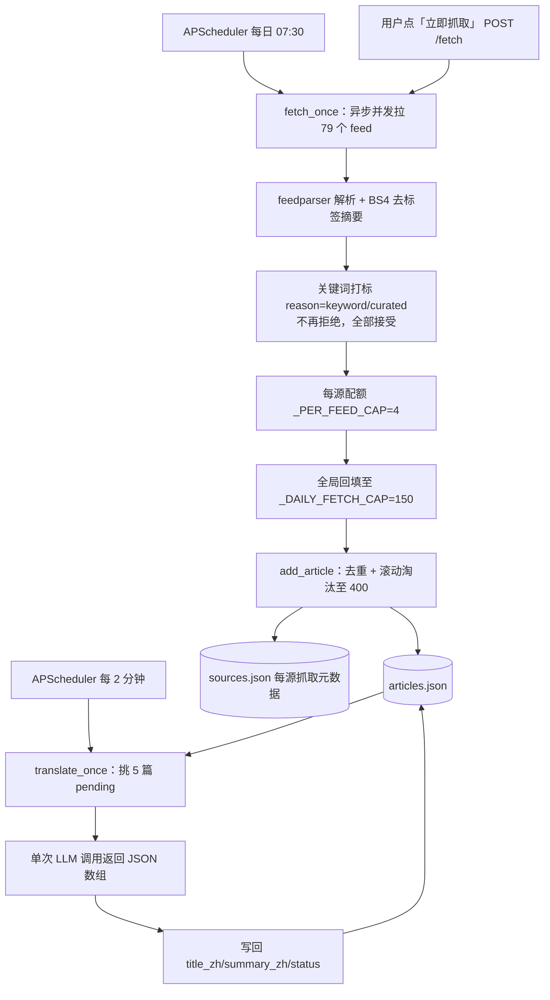

# RSS 抓取管线架构

> 讲清楚「一篇文章从 RSS 源到入库、再被译成中文」端到端怎么发生，以及背后那些
> 配额/打标/容量设计为什么这么定。涉及的文件：`app/workers/ai_news_fetcher.py`、
> `app/workers/ai_news_translator.py`、`app/routers/ai_news.py`（feed 清单 + 关键词表 + 入库）、
> `app/scheduler.py`（定时触发）。

## 1. 总览



## 2. 抓取（`fetch_once`）

### 2.1 触发方式

- **定时**：`scheduler.py` 注册 `CronTrigger(hour=7, minute=30)`（可经 `AIF_AI_NEWS_CRON_*` 配），时区 Asia/Shanghai。
- **手动**：`POST /api/ai-news/fetch` 即时跑一轮（前端「立即抓取」按钮）。

抓取是 token-thrifty 的——每天只自动跑一次，临时要新内容靠手动触发。

### 2.2 feed 清单与分类

79 个 feed 硬编码在 `ai_news.py` 的 `DEFAULT_FEED_SPECS`，每条是 `{url, name, tier, category, description}`。`category` 驱动前端分组，共 8 类：

| category | 含义 | 数量 |
|---|---|---|
| `vendor` | 官方实验室 / 厂商第一手发布 | 15 |
| `x-ai` | X(Twitter) 上的 AI 大 V | 24 |
| `community` | 社区 / 周刊（含中文资讯） | 12 |
| `expert` | 专家个人博客 | 9 |
| `blog` | AI 博客（原始一批） | 5 |
| `media` | 科技媒体 | 5 |
| `trending` | GitHub 热门风向 | 5 |
| `paper` | arXiv 论文类目 | 4 |

> 所有 feed 的 `tier` 当前都是 `high`。tier 原本用于分级过滤，现已弱化（见 2.4）。

### 2.3 rsshub.app 主机改写

很多 feed（Twitter/GitHub/Anthropic 等）写的是公共 `https://rsshub.app` 主机。模块加载时，若 `AIF_RSSHUB_BASE` 不等于公共实例，就**把所有 `rsshub.app` 前缀 URL 改写到配置的私有实例**（compose 内默认 `http://rsshub:1200`）。

原因：公共 `rsshub.app` 对 Twitter 路由 404、对 GitHub/Anthropic 路由 403；私有实例无此限制。Twitter 路由还需在 rsshub 容器配 `TWITTER_AUTH_TOKEN`（x.com 登录态 cookie）。详见 [部署指南](../guides/how-to-deploy.md)。

### 2.4 关键词打标（不再拒绝）

`_decide_relevance()` 当前**接受所有条目**——因为每个 feed 都是手挑的 AI 源，关键词预过滤已关闭。它仍会跑 `_is_ai_relevant_keywords()`（在标题+摘要里匹配 `AI_KEYWORDS` 中英关键词表），但结果只用于打 `ai_relevance` 标签（`keyword` 命中 / `curated` 未命中），**永远返回接受**。

> 这是从「关键词硬过滤」演进来的：早期 med/low tier 源要靠关键词命中才入库，现在全是 high tier 精选源，过滤逻辑保留但不生效。

### 2.5 每源配额 + 全局回填

这是抓取管线最关键的设计。**不是**简单按时间全局取 top-N，而是：

1. **每源配额**：每个 feed 先按时间倒序取自己最新的 `_PER_FEED_CAP=4` 篇 → `selected`。
2. **全局回填**：剩下的（leftover）按时间倒序，填满全局预算 `_DAILY_FETCH_CAP=150` 为止。

为什么这么做：纯全局时间排序会让高频 vendor 源（时间戳最新）挤掉慢但有价值的源——比如某 Twitter 账号最新一条是几天前的，永远进不了 top-N，于是「这个源好像从来没抓到东西」。每源配额保证每个源都有露脸机会。

每源抓取结果写入 `sources.json`（按 url 为 key）：`last_fetch` / `last_ok` / `last_error` / `eligible` / `last_added` / `last_filtered` / `name` / `tier` / `category`。前端「数据源」页读这个展示健康度。

### 2.6 入库与去重（`add_article`）

每条候选构造成 `Article` 调 `add_article()`：

- 用 `_article_id()`（url 的 sha1 前 12 位，前缀 `a_`）生成 id；按 id 或 url 去重，重复直接返回 `{duplicate: True}`。
- 新文章 `insert(0, ...)`（置顶最新），并标 `translation_status="pending"` 等翻译。
- 滚动淘汰：超过 `_ARTICLE_LIMIT=400` 时，**pinned 文章永不淘汰**，只从非 pinned 里保留最新的。

### 2.7 容错

- 单 feed 失败（HTTP 错误/超时/解析异常）只记进该源的 `last_error`，**绝不阻塞其它源**（`asyncio.gather(..., return_exceptions=True)`）。
- 每个 feed 只取前 20 个 entry；摘要截断到 280 字符。

## 3. 翻译（`translate_once`）

- **触发**：`scheduler.py` 每 2 分钟一个 `IntervalTrigger`（`max_instances=1, coalesce=True` 防堆积）；也可 `POST /translate/run` 手动跑一批。
- **选批**：挑 `translation_status` 不在 `{ok, failed, skipped}` 且没有 `title_zh`/`summary_zh` 的文章，一次 `BATCH_SIZE=5` 篇。
- **单次调用**：5 篇拼成一个 prompt，要求 LLM 返回**单个 JSON 数组**，每项 `{id, title_zh, summary_zh}`——比 5 次单独调用省钱。`_parse_response` 容忍 ```` ```json ```` 代码块包裹和数组外杂字符。
- **写回**：按 id 匹配写 `title_zh`/`summary_zh`，标 `translation_status="ok"`。
- **失败处理**：整批失败、或某篇在响应里缺失 → 标 `failed`。**`failed` 不会自动重试**（避免死循环），要重译得 `POST /articles/{aid}/retranslate` 把状态重置回 `pending`。

## 4. 其它 LLM 加工产物

抓取/翻译之外，新闻路由还有三类按需 LLM 产物（都走 `llm_client.chat_complete`，详见 [API 参考](../reference/api-reference.md)）：

| 产物 | 端点 | 存储 |
|---|---|---|
| 单篇深度解读（含 mermaid 图） | `POST /articles/{aid}/deep-dive` | `deep-dives/{aid}.json` |
| 每日速报（聚合最近 30h） | `POST /summary/today` | `summary_today.json` |
| 主题深度指南 | `POST /guides/generate` | `guides/guide_*.json` |
| 手动输入主题 → 深度解读 | `POST /manual-dive` | 合成一条 pinned 文章 + `deep-dives/{aid}.json` |

这些产物的存储结构见 [数据存储参考](../reference/data-storage.md)。
