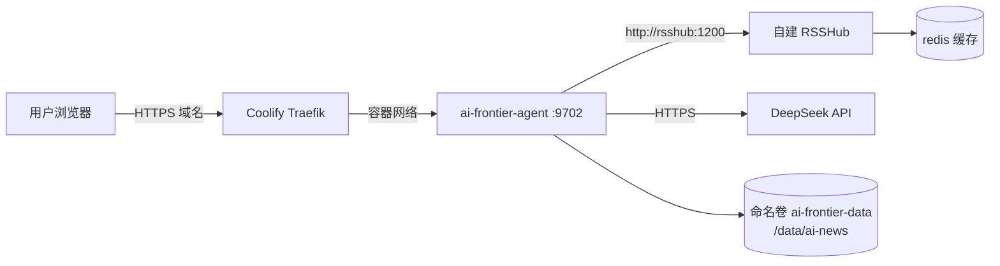

# 部署指南（Coolify + 自建 RSSHub）

> 本项目用 [Coolify](https://coolify.io/)（自托管 PaaS）部署，Coolify 用 Traefik 做反代、
> 管域名和 TLS。本地/裸机跑见 [运行指南](how-to-run.md)。

## 1. 拓扑

`docker-compose.yml` 定义三个服务：

| 服务 | 镜像 | 作用 |
|---|---|---|
| `ai-frontier` | 本仓库 Dockerfile | FastAPI 应用，进程内含抓取/翻译 scheduler，映射 `127.0.0.1:9702` |
| `rsshub` | `diygod/rsshub:latest` | 自建 RSSHub，把 Twitter/GitHub 等路由从公共实例迁到私有 |
| `rsshub-redis` | `redis:alpine` | rsshub 缓存后端，减少对上游重复请求、降被限流概率 |

## 2. 为什么要自建 RSSHub

88 个来源里仍有不少 X/GitHub 路由写的是公共 `https://rsshub.app`。但公共实例：

- 对 **Twitter 路由 404**
- 对部分 **GitHub 路由 403/限流**

应用启动时会把所有 `rsshub.app` 前缀的 URL 改写到 `AIF_RSSHUB_BASE`（compose 内默认 `http://rsshub:1200`，即自建实例）。这样这些源才抓得到。Anthropic/Cohere/Mistral/xAI 直接读取官方 sitemap，Qwen 读取官方文章 API，Ai2 读取官方 RSS，均不依赖 RSSHub；其中 sitemap index 最多展开同站 12 个子 sitemap，并对最新 6 页补全标题、摘要和发布时间。单源或单页失败都会隔离记录/降级，不阻塞其它来源。

**Twitter 路由额外需要登录态**：在 rsshub 容器配 `TWITTER_AUTH_TOKEN`（x.com 的 `auth_token` cookie）。留空则 Twitter 路由（24 个 x-ai 源）抓不到，其余源正常。这个 token 是登录凭证，**绝不写进代码/git**，在 Coolify 环境变量里手填。

## 3. 环境变量（在 Coolify UI 配）

| 变量 | 必填 | 说明 |
|---|---|---|
| `DEEPSEEK_API_KEY` | 是 | compose 同时映射给 `AIF_LLM_API_KEY`；翻译/速报/解读/对话全靠它 |
| `TWITTER_AUTH_TOKEN` | 否（要 Twitter 源则需） | x.com 登录 cookie，给 rsshub 容器 |
| `AIF_LLM_BASE_URL` | 否 | 默认 `https://api.deepseek.com` |
| `AIF_LLM_MODEL` | 否 | 默认 `deepseek-chat` |
| `AIF_RSSHUB_BASE` | 否 | 默认 `http://rsshub:1200`（容器网络内地址，别改成公共实例） |
| `AIF_SECRET_KEY` | **是（生产）** | 会话签名密钥；生成随机长值，不入 git |
| `AIF_COOKIE_SECURE` | **是（HTTPS）** | Coolify 域名走 HTTPS 时设 `1` |
| `AIF_ADMIN_EMAIL` | 建议 | 指定继承旧数据的管理员邮箱 |
| `AIF_DAILY_LLM_LIMIT` | 否 | 普通用户每日个人 LLM 调用额度，默认 50 |
| `AIF_AI_NEWS_INTERVAL_HOURS` / `AIF_SUMMARY_INTERVAL_HOURS` | 否 | 抓取与速报刷新间隔，默认均为 4 小时；compose 已透传 |
| `AIF_CORS_ORIGINS` | 否 | 内置同源 UI 留空；跨域时填明确 origin，不能 `*` |
| `AIF_SMTP_*` / `AIF_PUBLIC_BASE_URL` | 建议 | 非 admin 用户验证邮箱与找回密码所需 |

这些变量现已由 `docker-compose.yml` 显式透传，Coolify 中设置后会进入应用容器。完整配置项见 [配置参考](../reference/config-reference.md)。

## 4. 数据持久化

应用数据（articles.json / tracks.json / ui.db / deep-dives / reader-cache 等）全在 `/data/ai-news/`，挂在**命名卷** `ai-frontier-data`。

> 为什么用命名卷而不是相对路径 bind mount：Coolify 每次部署会换工作目录，相对路径 bind mount 会**丢数据**。命名卷与部署目录解耦。

首次启动卷为空时，`docker-entrypoint.sh` 会把镜像内 `seed-data/ai-news/` 灌进去（仅当 `articles.json` 不存在时；已有数据则跳过，保护真实数据）。

## 5. 部署步骤

1. 在 Coolify 新建一个 **Docker Compose** 应用，指向本仓库。
2. 配置 `DEEPSEEK_API_KEY`、随机 `AIF_SECRET_KEY`、`AIF_COOKIE_SECURE=1`；需要注册普通用户时再配 SMTP/Public URL；Twitter 源需要 `TWITTER_AUTH_TOKEN`。
3. 配置域名（Coolify 会自动签 TLS 并经 Traefik 反代到容器 `:9702`）。
4. 部署。首次会构建镜像、起三服务、灌种子数据。
5. 访问域名验证；`GET /api/health` 应返回 `{ok:true, llm_configured:true}`。
6. 注册首个账号（自动成为 admin），用管理员可见的「立即抓取」拉第一批真实数据；之后默认在 01/05/09/13/17/21 点抓取，晚一小时按候选变化刷新速报。

## 6. 健康检查

Dockerfile 内置 `HEALTHCHECK`，每 30s `curl http://127.0.0.1:9702/api/health`。Coolify 会据此判断容器健康。

## 7. 排障

| 现象 | 处理 |
|---|---|
| 数据源页大量「抓取失败」 | 检查 rsshub 容器是否起来：`docker compose logs rsshub`；确认 `AIF_RSSHUB_BASE` 是 `http://rsshub:1200` |
| Twitter 源全失败 | `TWITTER_AUTH_TOKEN` 没填或失效，重新从浏览器取 x.com 的 auth_token |
| LLM 功能 503 | `DEEPSEEK_API_KEY` 没配或额度用尽 |
| 部署后数据没了 | 检查是否误用 bind mount；应为命名卷 `ai-frontier-data` |
| HTTPS 下登录后仍像未登录 | 确认 compose 已透传 `AIF_COOKIE_SECURE=1`，域名确实通过 HTTPS 访问 |

> 仓库根的 `deploy/` 目录当前为空——没有入库的 systemd/nginx 配置，部署细节都托管给 Coolify。
